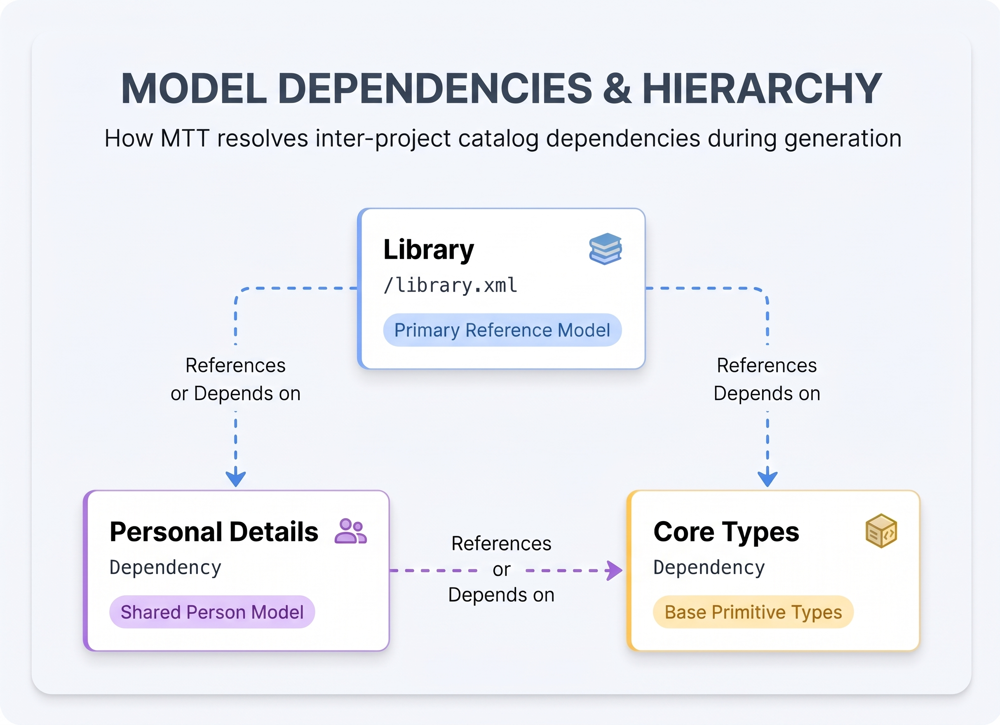

# Example Projects

Explore pre-configured sample projects demonstrating various information modeling techniques and how **Model Transform Tools (MTT)** converts graphical UML models into production-ready API specifications, schemas, and documentation.

---

## Sample Models Overview

-   **Library**

    ---

    **Type:** Primary Reference Model  
    **Domain:** Borrowers (Adult & Junior), Books, Loans, Librarians

    * **Techniques Covered:** Composition, Reflexive Relationships, Specialization (Inheritance), Association-Classes, Stereotypes, and Tagged Values.
    * **Key Feature:** The richest example project, providing a complete system to test drive generated APIs against a full domain model.

-   **Property Ownership**

    ---

    **Type:** Domain Relationship Model  
    **Domain:** Actors (People), Properties, Banks, Accounts

    * **Techniques Covered:** Complex multi-entity mapping, financial relationships, and **time-limited relationships** (e.g., period of property ownership).
    * **Key Feature:** Demonstrates how to handle temporal constraints and historical ownership tracking within models.

-   **Personal Details**

    ---

    **Type:** Model Dependency  
    **Domain:** Person Entities, Addresses, Contact Details

    * **Techniques Covered:** Reusable domain entity modeling, entity composition, and cross-project relationships.
    * **Key Feature:** Designed as a shared model dependency referenced directly by higher-level projects like **Library**.

-   **Core Types**

    ---

    **Type:** Foundational Data Types  
    **Domain:** Primitive & Extended Scalar Types

    * **Techniques Covered:** Base primitives (`Integer`, `Float`, `String`) and extended data types (`URL`, `URI`, `UUID`).
    * **Key Feature:** Acts as the primary foundation catalog imported and used across almost all MTT projects.

---

## Model Dependencies & Hierarchy

The sample projects illustrate how MTT resolves inter-project catalog dependencies during generation:

*Figure 1: Relationship and dependency flow across the sample model repositories.*

---

## Output Artifacts

Each example repository includes pre-configured execution rules to generate target specifications:

=== "OpenAPI Specs"

    ### RESTful API Contracts
    Generates complete OpenAPI 3.0+ REST endpoints, request/response payloads, and schema definitions derived directly from class attributes and associations.

=== "GraphQL Schemas"

    ### Type Definitions & Queries
    Compiles GraphQL type definitions, input types, and query interfaces representing entity relationships and inheritance structures.

=== "Markdown Documentation"

    ### Static Model Documentation
    Produces structured Markdown files documenting model entities, which compile into static reference websites using Material for MkDocs.

---

!!! tip "Test Drive Sample Models"
    Ready to run transformations on these models? Select **`library`** or **`core-types`** directly from the project selection menu in **MTT Manager**.
