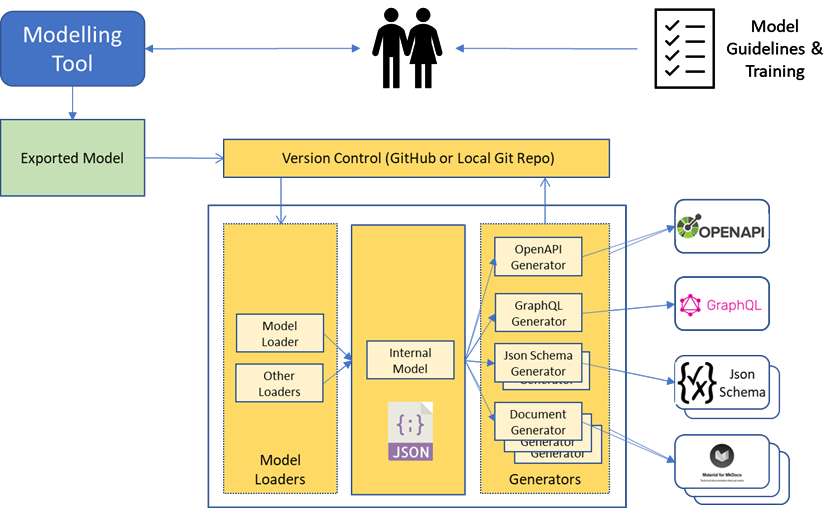

# MTT Overview

Learn about the core architecture, internal model pipeline, and deployment models of the **Model Transform Tools (MTT)**.

---

## Tool Structure

The diagram below illustrates the key structural components of the MTT transformation pipeline:

*Figure 1: High-level MTT structure and data transformation pipeline*

---

## Key Components

-   **Model Loaders**

    ---

    * **Default Tool:** Sparx Enterprise Architect (EA) via exported XML.
    * **Custom Loaders:** Ingest any structured information model into the internal metadata format.

-   **Internal Model**

    ---

    * **Multi-Language Generators:** Build custom generators easily using standard programming languages.
    * **Model Dependencies:** Re-use a shared catalog of information models across distinct projects.

-   **Output Generators**

    ---

    * **Agnostic Domain Models:** Operates on business domain models agnostic to specific outputs.
    * **Intelligent Mapping:** Translates models into OpenAPI, GraphQL, Protobuf, and Markdown documentation.
    * **Built-in Best Practices:** Enforces architectural guidelines and local organizational rules.

-   **CI/CD & Automation**

    ---

    * **Automated Artifacts:** Re-generate specifications automatically on every pull request or commit.
    * **GitHub Actions:** Native action integration for publishing versioned specifications.
    * **Docker Uniformity:** Identical execution pipeline across local developer tools and cloud builds.

---

## Deployment Options

Select the deployment model that matches your infrastructure requirements:

=== "Cloud / GitHub Web Service"

    ### Managed Web Instance
    Run transformations directly via the managed web service at [mtt.apigeneration.tech](https://mtt.apigeneration.tech).

    * **GitHub Repositories:** Connect public or private GitHub repositories for automated transformations.
    * **CI/CD Integration:** Integrate directly into GitHub Actions workflows to auto-generate specifications on push or pull request.
    * **Sample Walkthroughs:** Test drive transformations immediately using pre-configured [Example Projects](../example-projects/).

=== "Local Infrastructure (Docker)"

    ### On-Premises / Local Container
    Deploy MTT inside your local network or developer environment using the official Docker container.

    * **Data Privacy:** Keep domain models completely on-premises.
    * **Docker Volumes:** Mount local file systems and project repositories directly to Docker volumes for read/write access.
    * **CLI Execution:** Run fast local transformations during active model development.

---

!!! tip "Next Steps"
    * Explore how projects and configuration files are structured in [Project Structure](../projects/).
    * Check out step-by-step instructions for running transformations in [Running the Tool](../running-mtt/).
