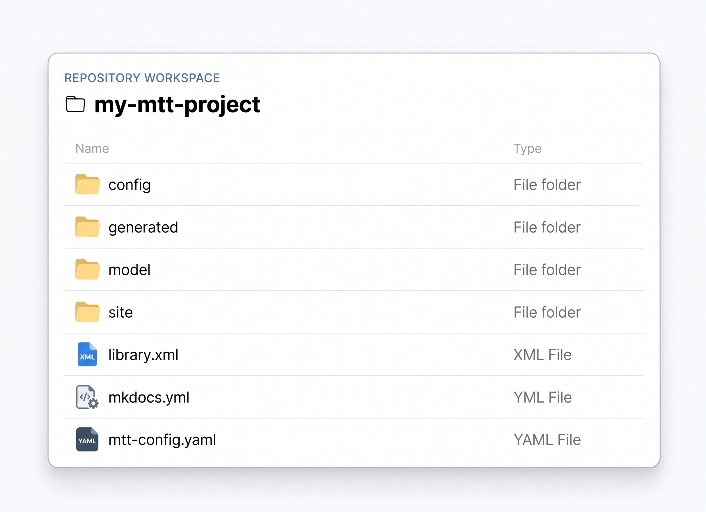

# Project Structure

Projects are where the key inputs, configurations, and output artifacts for the **Model Transform Tools (MTT)** are stored.

---

## Folder & File Layout

The diagram below illustrates the standard file directory layout used across MTT projects:

*Figure 1: Standard MTT project repository structure*

---

## Core Components

- **Exported Information Model**  
  The UML or domain definition containing the information types, relationships, and attributes used as input for generation (e.g., `library.xml` in the example above).

- **`mtt-config` File**  
  The primary configuration file specifying project-specific runtime settings, such as which model loader to execute, active output generators, and inter-project catalog dependencies.

- **`config/` Folder**  
  Holds project-specific loader or generator rules. Common configuration files shared across multiple projects can be defined once and referenced inside individual `mtt-config` files.

- **`generated/` Folder**  
  The destination directory where generated specs, schemas, and documentation are written. Folder structures are defined within `mtt-config` and created automatically by MTT during execution.

- **Additional Files & Assets**  
  Repositories can store supplementary files alongside core MTT inputs. For example:
    * Published Sparx EA HTML models stored under `model/` ([View Library Model](https://mtt.apigeneration.tech/repo-static/library/model/index.htm)).
    * Markdown documentation built via MkDocs into static sites ([View Library Documentation](https://mtt.apigeneration.tech/repo-static/library/site/index.html)).

---

## Hosting Environments

The directory structure and configuration files remain identical whether hosted in GitHub repositories or on local file systems. Select your hosting model below:

=== "GitHub Projects"

    ### Managed Version Control Integration
    MTT provides native integration with GitHub repositories to streamline retrieving inputs and committing generated artifacts.

    * **Application Authorization:** Requires MTT to be registered as a GitHub Application for your account or organization.
    * **Automated CI/CD:** Can be invoked directly within GitHub Actions pipelines as part of automated build workflows.
    * **Automatic Commits:** Generated specifications are committed and pushed back to your target repository automatically.

=== "Local Projects"

    ### On-Premises File System
    Local projects can be stored anywhere on a local file system, though using a structured repository base (e.g., `repo-base/`) is recommended.

    * **Local Execution:** Managed through the local Docker container interface.
    * **Manual Version Control:** Unlike GitHub-hosted projects, version control via Git must be managed manually by the user.
    * **Docker Volume Mounts:** Requires read/write access to mapped directory volumes.

---

!!! tip "Explore Examples"
    Want to see a real-world repository layout in action? Check out our pre-configured sample models in [Example Projects](../example-projects/).
