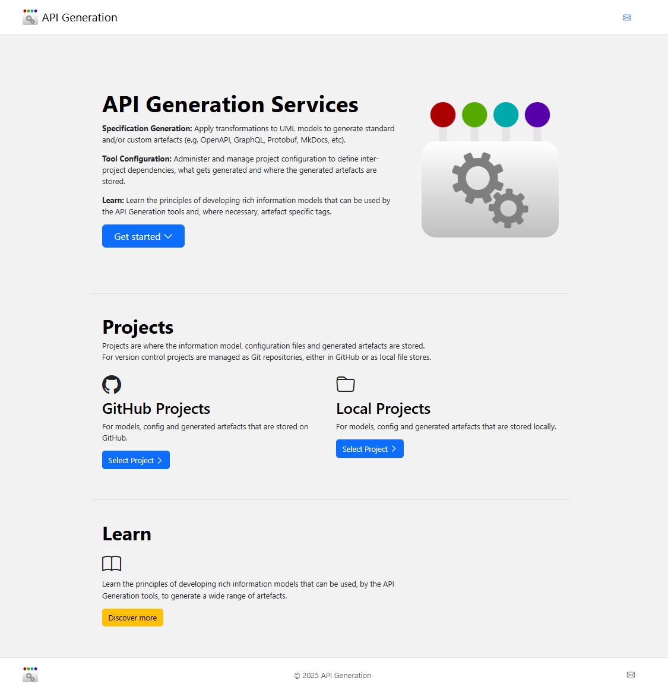
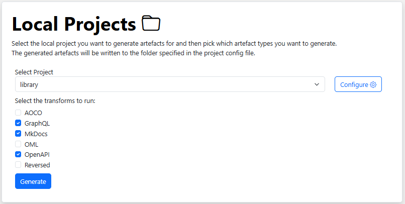
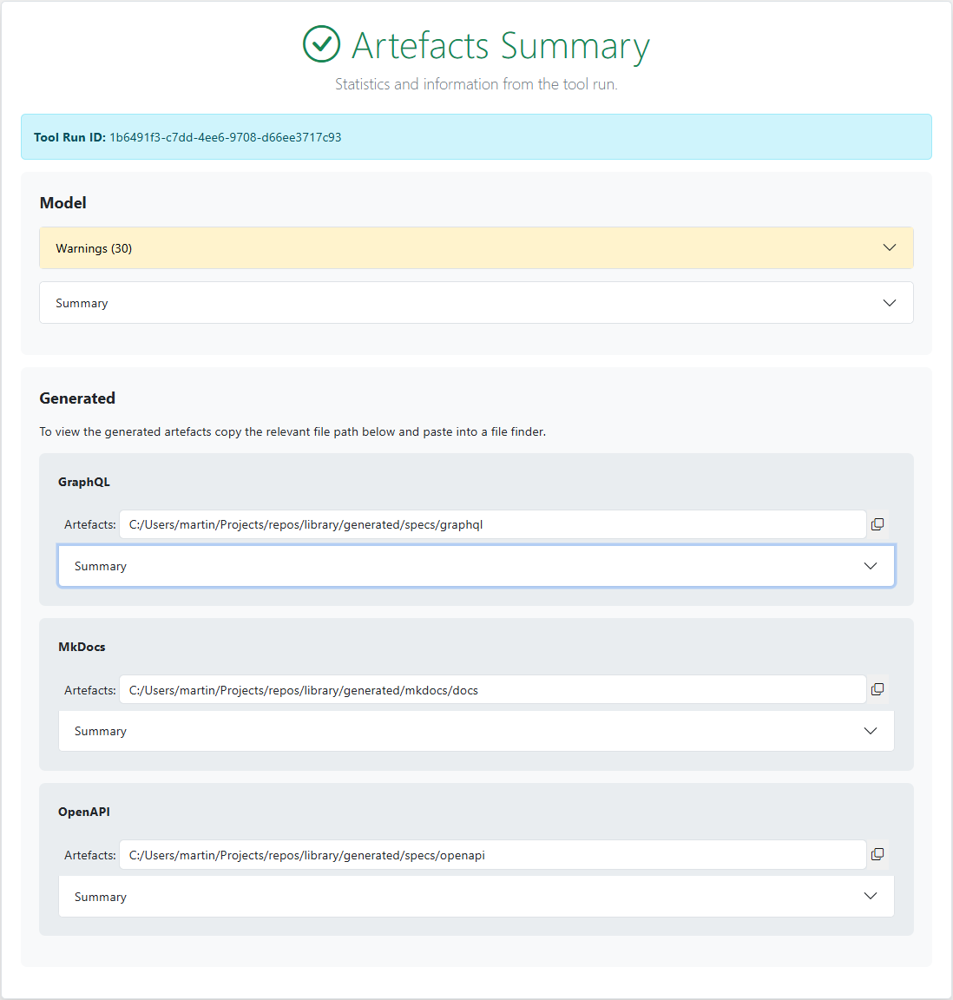

# Running the Tool

Learn how to navigate the **Model Transform Tools (MTT)** web application interface, execute generator pipelines on your projects, and access generated output artifacts.

---

## MTT Home Page Overview

The MTT home page serves as the main launchpad for managing transformation projects and accessing learning resources:

*Figure 1: High-level MTT application home page layout*

The home interface is organized into two primary sections:

* **Projects:** Access and manage your model transformations across GitHub and local repositories.
* **Learn:** Access technical documentation, architecture guides, and transformation walkthroughs.

---

## Executing Generators

To run transformation pipelines on an information model, select a project from either the **GitHub Projects** or **Local Projects** dashboard.

*Figure 2: Selecting a project and enabling generator pipelines*

### Step-by-Step Execution Workflow

1. **Select Project:** Choose your target repository from the project dropdown menu.
2. **Select Generators:** Check the boxes for the specific output generators you wish to run (e.g., OpenAPI, GraphQL, Protobuf, Markdown Documenter).
3. **Trigger Execution:** Click **Run Generation** to initiate automatic model validation and pipeline execution.

---

## Generation Output & Results

Once execution completes, MTT displays one of two outcome pages based on model validation:

=== "Artefacts Summary (Success)"

    ### Successful Run Output
    If model validation passes without critical errors, MTT executes the selected generators and displays the **Artefacts Summary** page.

    

    *Figure 3: Artefacts Summary page showing model statistics and generated outputs*

    The summary page is divided into two key sections:

    #### 1. Model Summary
    * **Validation Warnings:** Displays collapsible dropdowns detailing any warnings identified during model parsing. Warnings should be reviewed and addressed, but do not block generator execution.
    * **Model Overview:** Provides high-level metrics and structural metadata for the parsed information model.

    #### 2. Generator Summary
    * **Generated Artifacts:** Outlines all schemas, specifications, and documentation files created by each active generator.
    * **Accessing Output Files:**
        * **GitHub Projects:** Provides direct hyperlinks to the output folders within your GitHub repository.
        * **Local Projects:** Displays absolute local file paths to output directories (due to browser security restrictions). Copy and paste the absolute path into your operating system's file browser to view generated files.

=== "Validation Error Page (Requires Fix)"

    ### Error Handling & Troubleshooting
    If model validation detects critical issues that would cause generators to fail, execution halts immediately and the **Error Page** is displayed.

    !!! failure "Critical Validation Errors"
        All reported validation errors must be resolved in your source modeling tool before MTT can successfully process the project.

    #### Common Error Causes
    * **Missing Dependencies:** Referenced external models or shared catalog packages are missing from the project path.
    * **Sub-Package Export:** Selecting a nested sub-folder instead of the root model package during export from Sparx Enterprise Architect or your modeling tool.
    * **Syntax / Schema Violations:** Malformed entity relationships or unresolvable data types in the exported XML model.

---

## Learn Section

The **Learn** portal provides complete documentation, architectural blueprints, and step-by-step guides for designing robust information models suited for automated specification generation.

---

!!! tip "Next Steps"
    * Check repository layout guidelines in [Project Structure](../projects/).
    * Learn how to extend target outputs in [Developing New Generators](../new-generators/index.md).
