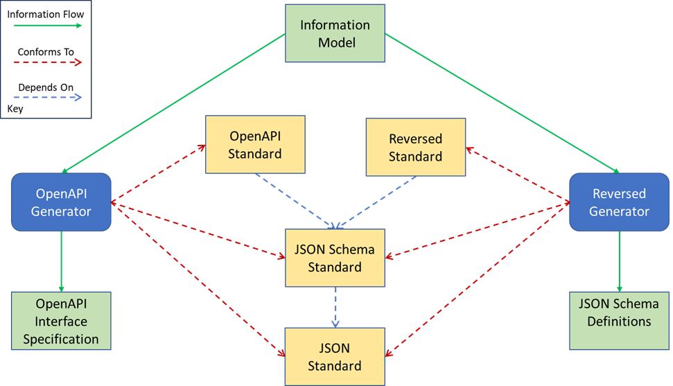

# Generators

Running one or more generators over an information model to produce concrete output files is the primary purpose of the **Model Transform Tools (MTT)**.

---

## Existing Generators

MTT provides several pre-built generators out of the box, categorized by output artifact type:

-   **API Specification Generators**

    ---

    * **[OpenAPI Specifications](https://swagger.io/specification/):** Generates RESTful interface contracts complying with the OpenAPI 3.0+ standard.
    * **[GraphQL Specifications](https://graphql.org/):** Generates type definitions and operation schemas conforming to GraphQL standards.

-   **Schema Definition Generators**

    ---

    * **AOCO (Common Services):** Produces Micro Format Definition (MGD) documents for C2/military information exchange.
    * **Reversed Schema:** Generates JSON Schema definitions conforming to the custom Reversed specification format.

-   **Documentation Generators**

    ---

    * **Information Model Documenter:** Generates standard [Markdown](https://www.markdownguide.org/basic-syntax/) files documenting entity structures.
    * **Static Sites:** Compiles generated Markdown directly into technical documentation portals using [Material for MkDocs](https://squidfunk.github.io/mkdocs-material/).

---

## Developing New Generators

As detailed in the [MTT Overview](../mtt-overview/index.md), the core architecture of the MTT Internal Model is designed to make creating custom generators fast, flexible, and language-agnostic.

When building a new generator, it is essential to understand how target specifications depend on underlying syntax standards:

*Figure 1: Relationship between low-level syntax formats and higher-level schema semantics*

---

## Architectural Principles

=== "1. Standard Dependencies"

    ### Layered Standards
    Higher-level specifications build upon foundational data formats. For instance, both **OpenAPI** and **Reversed** standards rely directly on the **[JSON Schema Standard](https://json-schema.org/)** and underlying **[JSON Standard](https://www.json.org/)** for basic syntax.

=== "2. Dual Conformance"

    ### Syntax vs. Semantics
    Custom generators must enforce two distinct compliance levels:

    * **Format (Syntax):** Conforming to base rules (e.g., valid JSON/YAML formatting and basic JSON Schema datatypes).
    * **Structure (Semantics):** Enforcing higher-level domain rules and enterprise standards defined by the specific target output (e.g., OpenAPI endpoints, operation paths, or GraphQL resolvers).

---

!!! tip "Next Steps"
    * Check how generator rules are specified in [Project Structure](../projects/index.md).
    * Learn how to trigger generators locally or via CI/CD in [Running the Tool](../running-mtt/index.md).
