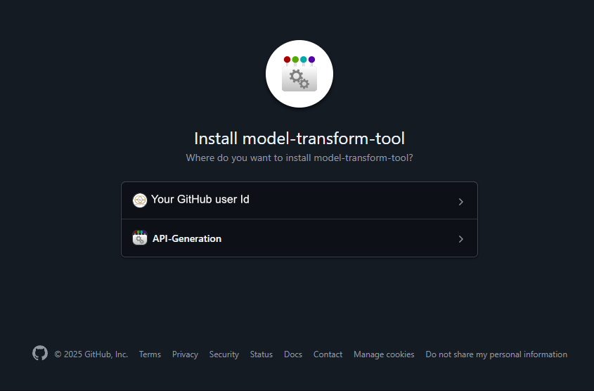
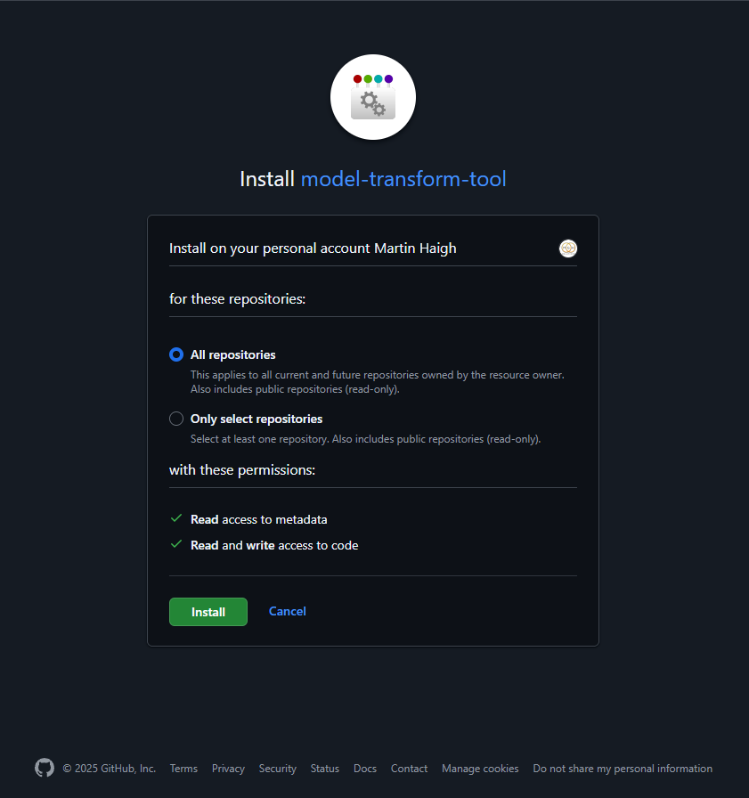
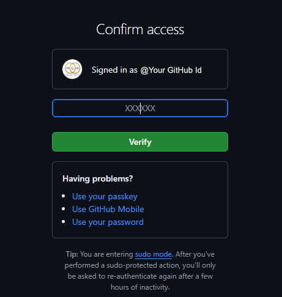
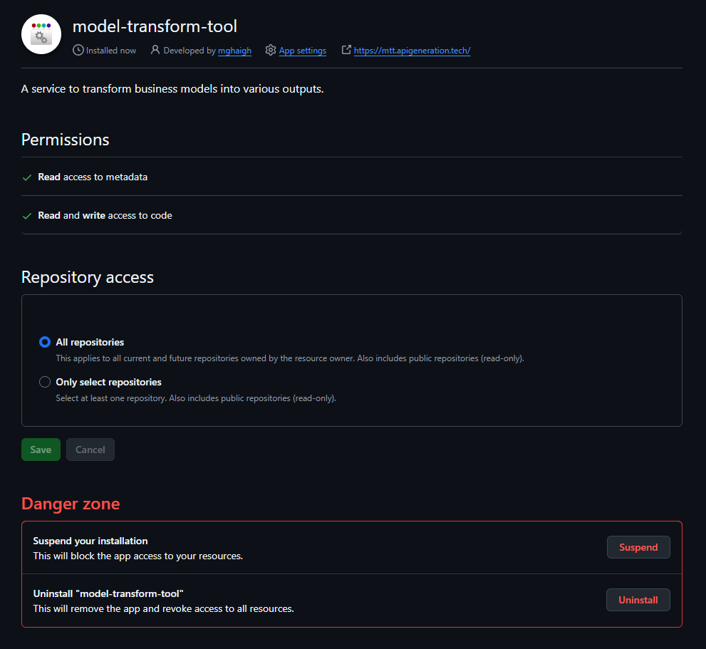
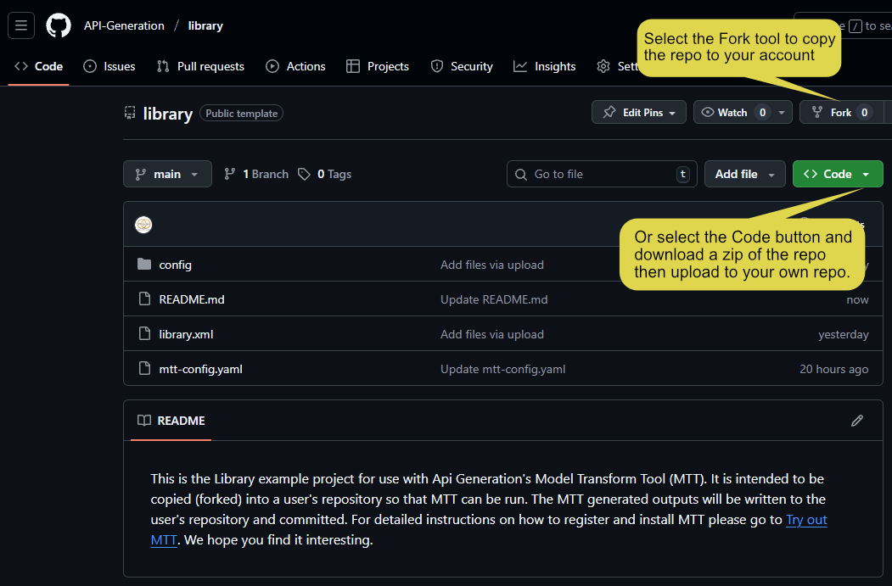
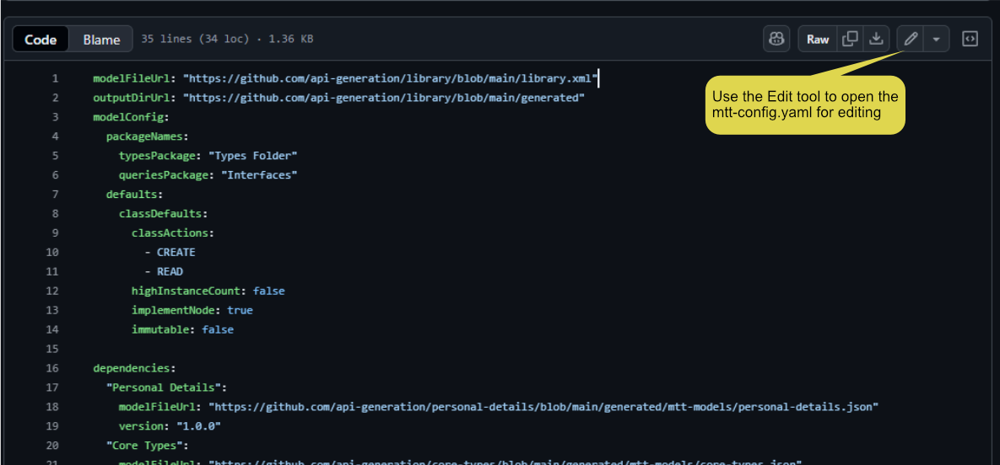
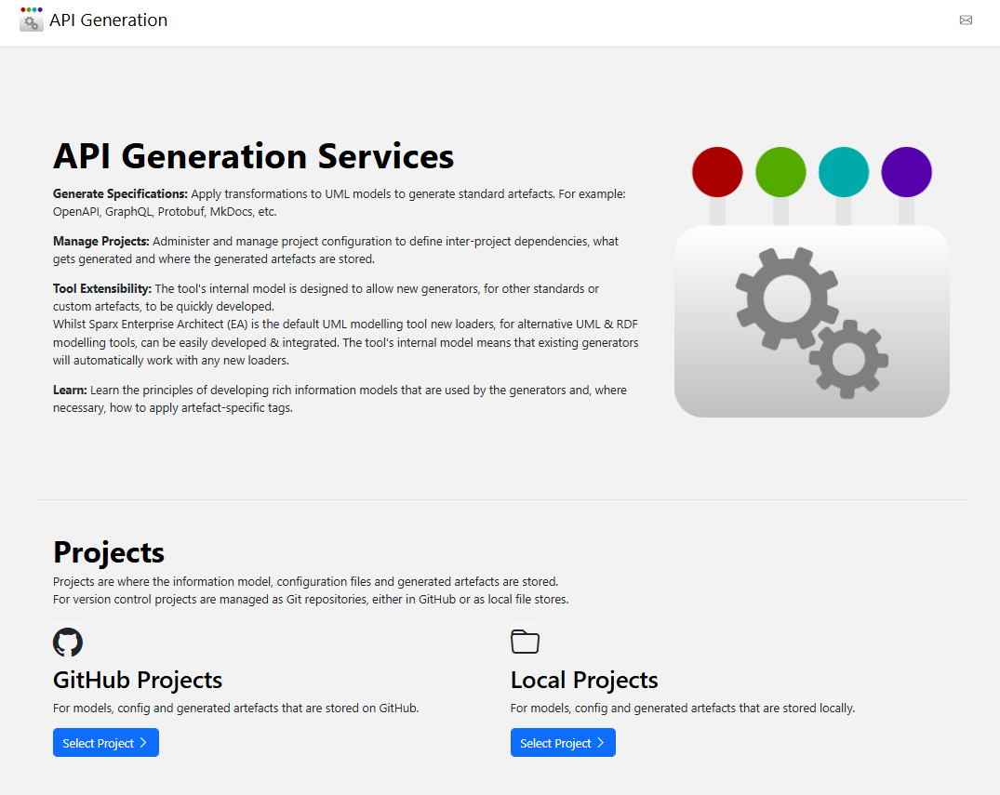
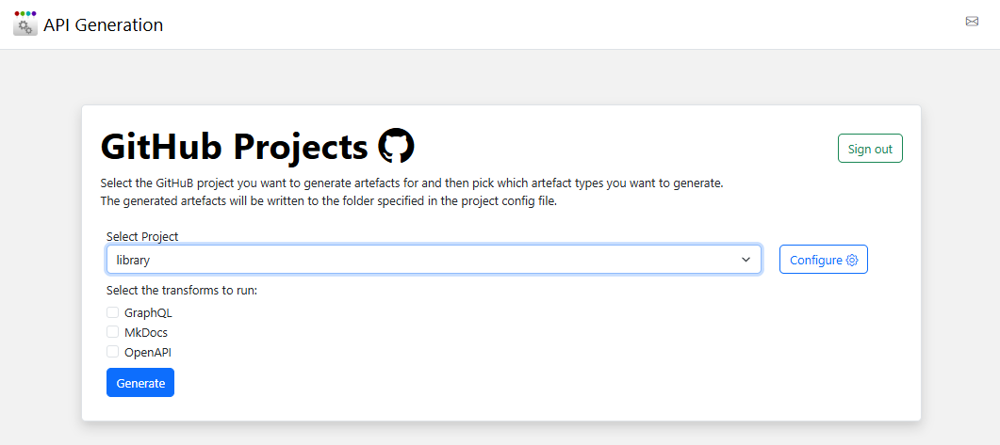

# Try Model Transform Tools (MTT)

Test drive the **Model Transform Tools (MTT)** to evaluate how graphical domain models transform into production-ready API specifications, schemas, and static documentation sites.

---

## Evaluation Options

Select one of two pathways to evaluate MTT based on your workflow needs:

-   **Option 1: Explore Example Projects**

    ---

    Browse pre-configured sample models (`Library`, `Property Ownership`, `Personal Details`, `Core Types`) along with their auto-generated OpenAPI, GraphQL, and Markdown outputs.

    [:octicons-arrow-right-24: View Example Projects](../learn/example-projects/)

-   **Option 2: Install GitHub App Trial**

    ---

    Connect the MTT GitHub App to your account to execute transformations on your own models and automatically commit generated artifacts back to your repositories.

    [:octicons-arrow-right-24: Install GitHub App](https://github.com/apps/model-transform-tool/installations/new){ target="_blank" }

---

!!! info "Trial Account Capabilities & Limits"
    The trial version allows you to test real-world transformations directly in your GitHub repositories. Trial accounts include the following parameters:

    * **Model Complexity:** Maximum of **7 classes** per information model.
    * **Dependencies:** Model references are limited to the official `core-types` library.
    * **Execution Quota:** Up to **5 transformation runs** per registered user.
    * **Production Access:** To remove limits and create custom model libraries, subscribe via the [GitHub Marketplace](https://github.com/marketplace).

---

## Setting Up MTT as a GitHub App

Follow these steps to authorize the MTT GitHub App and configure repository permissions:

### Step 1: Initiate Installation
Navigate to the [MTT GitHub App Installation Page](https://github.com/apps/model-transform-tool/installations/new){ target="_blank" } and select the target GitHub personal account or organization where you plan to host your models.

*Figure 1: Account selection prompt for MTT installation.*

### Step 2: Configure Repository Permissions
Grant MTT access to either **All repositories** or select **Only select repositories**. Review the requested read/write permissions required for model parsing and committing generated outputs.

*Figure 2: Configuring repository access controls and permissions.*

### Step 3: Verify Two-Factor Authentication (2FA)
If 2FA is enabled on your GitHub account, confirm authentication to complete the authorization handshake.

*Figure 3: Two-factor authentication verification step.*

### Step 4: Installation Confirmation
Upon completion, GitHub displays the active installation status along with options to configure repository access, disable, or uninstall the app.

*Figure 4: Confirmed MTT GitHub App installation dashboard.*

---

## Executing a Transformation Pipeline

Once the GitHub App is installed, test the transformation pipeline using the official **Library** sample repository:

### 1. Fork the Sample Repository
Navigate to the official [API-Generation / Library Repository](https://github.com/API-Generation/library){ target="_blank" } and create a **Fork** in your GitHub account (or download and push the contents to a new repository in your account).

*Figure 5: Official Library sample model repository on GitHub.*

### 2. Configure Project Execution Rules
In your repository fork, edit `mtt-config.yaml` to specify target generation outputs, active model loaders, and branch commit rules. Commit and push your updates.

*Figure 6: Customizing runtime settings in mtt-config.yaml.*

### 3. Open MTT Manager Portal
Launch the [MTT Manager Workspace](https://mtt.apigeneration.tech){ target="_blank" }. Select **GitHub Projects** to fetch your connected repositories.

*Figure 7: MTT Manager web application launchpad.*

### 4. Select Project and Run Generators
Select your target repository from the dropdown menu, check the boxes for the desired output generators (e.g., OpenAPI, GraphQL, Protobuf, MkDocs), and click **Run Generation**.

*Figure 8: Triggering output generators for a GitHub project.*

---

!!! warning "Documentation Build Times"
    When enabling the **MkDocs Generator**, MTT compiles complete multi-page documentation suites and writes a large file tree directly to your GitHub repository. This process may take **2–3 minutes** to complete.

---

!!! tip "Next Steps"
    * Review repository file structures in [Project Structure](../learn/projects/).
    * Explore runtime output summaries in [Running the Tool](../learn/running-mtt/).
